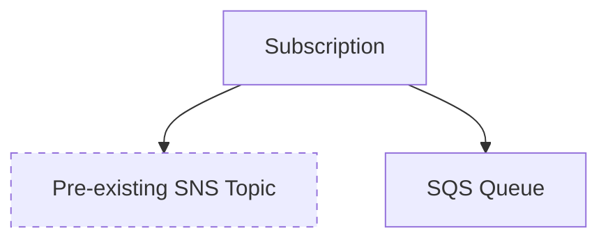

# LocalStack CloudFormation Custom Types Demo

> [!WARNING]
> 🚧 This project is currently work in progress and not ready for use.

This is a work in progress demo of [managing extensions with the CloudFormation registry](https://docs.aws.amazon.com/AWSCloudFormation/latest/UserGuide/registry.html).

## Overview

The CloudFormation registry is a centralized hub for discovering and managing extensions—including custom resource types, modules, and Hooks from AWS, third-party providers, and your own custom sources—that extend CloudFormation's capabilities. It lets you activate public or private extensions in your AWS account and use them in templates just like built-in AWS resources, simplifying the process of integrating third-party or custom infrastructure components into your infrastructure-as-code.

This example extension implements the reliable delivery pattern for triggering lambda functions, and manages the lifecycle of two resources commonly used together:

* An SQS queue, and
* An SNS subscription subscribing the queue to an already existing SNS topic.

## Building the extension

The project requires the following:

* Java 17
* Maven
* The [CloudFormation CLI](https://github.com/aws-cloudformation/cloudformation-cli)
    * Python < 3.14
    * `pip install cloudformation-cli cloudformation-cli-java-plugin 'setuptools<81'`

Build with

    mvn package

which creates the `target/localstack-testing-resource-handler-1.0-SNAPSHOT.jar` output file. 

## Deploying to AWS/LocalStack

Submit your extension to AWS or LocalStack with 

    cfn submit --set-default

which also sets the new extension version as the default version for use with CloudFormation.

### Choosing between AWS and LocalStack

Our recommendation is that AWS profiles are used to select between AWS destinations. For more information about configuring the AWS CLI to use profiles to target LocalStack, [see our documentation](https://docs.localstack.cloud/aws/integrations/aws-native-tools/aws-cli/#configuring-a-custom-profile).

## Testing

This project includes `testtemplate.yaml` which is an example usage of this extension.

---

_Original README_

# LocalStack::Testing::Resource

Congratulations on starting development! Next steps:

1. Write the JSON schema describing your resource, `localstack-testing-resource.json`
1. Implement your resource handlers.

The RPDK will automatically generate the correct resource model from the schema whenever the project is built via Maven. You can also do this manually with the following command: `cfn generate`.

> Please don't modify files under `target/generated-sources/rpdk`, as they will be automatically overwritten.

The code uses [Lombok](https://projectlombok.org/), and [you may have to install IDE integrations](https://projectlombok.org/setup/overview) to enable auto-complete for Lombok-annotated classes.
